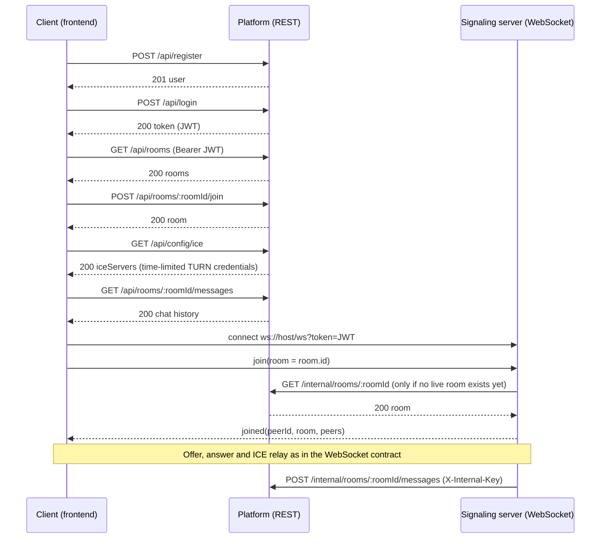

# REST API Contract v1.1

This document defines the REST API provided by the WebRTC meeting app's platform backend
(`/platform`, owned by Member 3). The frontend (Member 1) consumes it. The real-time service
(Member 2) and the platform also call each other through the [Internal API](#internal-api) to keep
rooms and user permissions consistent.

**v1.1 is approved by all 3 members.** It aligns v1.0
with [token-contract.md](./token-contract.md) v1.1 (the `role` claim), and adds the user
management API (`/api/admin/users`) and the `ACCOUNT_DISABLED` error that the frontend already
uses. Changes from v1.0 are listed in [Changes from v1.0](#changes-from-v10).

The authentication token is defined in [token-contract.md](./token-contract.md). The signaling
protocol is defined in [websocket-contract.md](./websocket-contract.md). This document must not
contradict either of them.

## Conventions

| Topic          | v1.1 rule                                                                                                                                   |
| -------------- | ------------------------------------------------------------------------------------------------------------------------------------------- |
| Base path      | All public endpoints start with `/api`. In a deployed environment, Nginx routes `/api/` to the platform service and `/ws` to the real-time. |
| Format         | Request and response bodies are UTF-8 JSON. Requests with a body must send `Content-Type: application/json`.                                |
| Authentication | Protected endpoints require `Authorization: Bearer <JWT>`. The JWT is the one issued by `POST /api/login`.                                  |
| Identifiers    | All identifiers (`id`, `userId`, `roomId`, message `id`) are opaque, non-empty strings. Clients must not parse them or assume an order.     |
| Timestamps     | ISO 8601 in UTC with milliseconds, for example `2026-11-10T03:30:00.000Z`. This matches the `ts` field of the WebSocket `chat` message.     |
| Unknown fields | The server ignores unknown request fields. Clients must ignore unknown response fields.                                                     |
| Transport      | Use HTTPS outside local development.                                                                                                        |

## Endpoint overview

| Method   | Path                               | Auth                   | Owner of the data | Purpose                                                          |
| -------- | ---------------------------------- | ---------------------- | ----------------- | ---------------------------------------------------------------- |
| `POST`   | `/api/register`                    | None                   | Platform          | Create a user account.                                           |
| `POST`   | `/api/login`                       | None                   | Platform          | Verify credentials and issue a JWT.                              |
| `GET`    | `/api/me`                          | JWT                    | Platform          | Return the current user.                                         |
| `GET`    | `/api/rooms`                       | JWT                    | Platform          | List rooms.                                                      |
| `POST`   | `/api/rooms`                       | JWT                    | Platform          | Create a room.                                                   |
| `GET`    | `/api/rooms/:roomId`               | JWT                    | Platform          | Return one room.                                                 |
| `POST`   | `/api/rooms/:roomId/join`          | JWT                    | Platform          | Check that the user may join a room before the WebSocket `join`. |
| `DELETE` | `/api/rooms/:roomId`               | JWT (creator or admin) | Platform          | Delete a room and its chat history.                              |
| `GET`    | `/api/rooms/:roomId/messages`      | JWT                    | Platform          | Return stored chat history, newest page first.                   |
| `GET`    | `/api/config/ice`                  | JWT                    | Platform          | Return STUN/TURN servers with time-limited credentials.          |
| `GET`    | `/api/admin/stats`                 | JWT (admin)            | Platform          | Return usage statistics.                                         |
| `GET`    | `/api/admin/users`                 | JWT (admin)            | Platform          | List or search users.                                            |
| `POST`   | `/api/admin/users`                 | JWT (admin)            | Platform          | Create a user with a role.                                       |
| `PATCH`  | `/api/admin/users/:id`             | JWT (admin)            | Platform          | Change a user's role or disabled flag.                           |
| `POST`   | `/api/admin/users/:id/password`    | JWT (admin)            | Platform          | Set a new password for a user.                                   |
| `DELETE` | `/api/admin/users/:id`             | JWT (admin)            | Platform          | Delete a user.                                                   |
| `GET`    | `/internal/rooms/:roomId`          | Internal key           | Platform          | Real-time checks that a room exists.                             |
| `POST`   | `/internal/rooms/:roomId/messages` | Internal key           | Platform          | Real-time stores a chat message.                                 |
| `POST`   | `/internal/rooms/:roomId/close`    | Internal key           | Real-time         | Platform closes a live room.                                     |
| `POST`   | `/internal/users/:userId/revoke`   | Internal key           | Real-time         | Platform revokes a user's live access.                           |

The `/internal/*` endpoints are for service-to-service calls only. Nginx must not expose them to
the internet (see [Internal API](#internal-api)).

## Authentication

### `POST /api/register`

Creates an account. It does not return a token; the client then calls `POST /api/login`.

Request:

```json
{ "username": "alex", "password": "correct horse battery" }
```

Response `201 Created`:

```json
{
  "user": {
    "id": "user-123",
    "username": "alex",
    "role": "user",
    "createdAt": "2026-11-10T03:30:00.000Z"
  }
}
```

| Status | Error code         | When                                                                                |
| ------ | ------------------ | ----------------------------------------------------------------------------------- |
| `400`  | `VALIDATION_ERROR` | `username` or `password` breaks the rules in [Validation rules](#validation-rules). |
| `409`  | `USERNAME_TAKEN`   | The username already exists (compared case-insensitively).                          |
| `429`  | `RATE_LIMITED`     | Too many requests from this client.                                                 |

### `POST /api/login`

Verifies the credentials and issues the JWT defined in the token contract.

Request:

```json
{ "username": "alex", "password": "correct horse battery" }
```

Response `200 OK`:

```json
{
  "token": "<JWT>",
  "tokenType": "Bearer",
  "expiresIn": 3600,
  "user": { "id": "user-123", "username": "alex", "role": "user" }
}
```

The JWT payload contains `userId`, `username`, `role`, `iat` and `exp`, signed with `HS256` and
`JWT_SECRET`, and expires one hour after issuance. `userId` is the same value as `user.id` and
must be a string. `role` is `user` or `admin`, read from the database at login; a client can never
choose its own role. The real-time service reads `role` from the verified claim for its `/admin/*`
API and `/ws/admin` feed.

On every protected REST request the platform also reads the user's current `role` and `disabled`
flag from the database. A role change or a block therefore takes effect immediately for REST calls,
even though an old token stays valid for up to one hour.

The client uses the same token for REST (`Authorization` header) and for the WebSocket
(`ws://host/ws?token=<JWT>`). The client should store the token in memory or `sessionStorage` and
log in again after `TOKEN_EXPIRED`. There is no refresh endpoint in v1.1.

| Status | Error code            | When                                                                                   |
| ------ | --------------------- | -------------------------------------------------------------------------------------- |
| `400`  | `VALIDATION_ERROR`    | A field is missing or has the wrong type.                                              |
| `401`  | `INVALID_CREDENTIALS` | The username does not exist or the password is wrong. Both cases use the same message. |
| `403`  | `ACCOUNT_DISABLED`    | The password is correct but an administrator disabled the account.                     |
| `429`  | `RATE_LIMITED`        | Too many requests from this client.                                                    |

### `GET /api/me`

Response `200 OK`:

```json
{ "user": { "id": "user-123", "username": "alex", "role": "user" } }
```

Errors: `401 INVALID_TOKEN`, `401 TOKEN_EXPIRED`.

## Rooms

A room has this shape:

```json
{
  "id": "room-7f3a",
  "name": "Study room",
  "maxPeers": 4,
  "createdBy": { "id": "user-123", "username": "alex" },
  "createdAt": "2026-11-10T03:30:00.000Z"
}
```

**The room `id` is the value the client sends as `room` in the WebSocket `join` message.** The
room `name` is only a label for the lobby. `maxPeers` is informational; the real-time service
enforces the limit and replies `ROOM_FULL` when a room is full.

The platform is the source of truth for which rooms exist. The real-time service creates live room
state only after the platform confirms the room: when a peer sends `join` for a room that has no
live state yet, the real-time service calls `GET /internal/rooms/:roomId`. If the platform answers
`404`, the join is rejected with the WebSocket error `ROOM_NOT_FOUND`. If the platform cannot be
reached, the join is rejected with `SERVICE_UNAVAILABLE`. A live room is not checked again on later
joins. The first peer to join becomes the live owner, which is not necessarily `createdBy`.

### `GET /api/rooms`

Response `200 OK`: `{ "rooms": [ <room>, ... ] }`, sorted by `createdAt` descending. The list is
not paginated because the number of rooms is capped (see [Limits](#limits)).

### `POST /api/rooms`

Request:

```json
{ "name": "Study room" }
```

Response `201 Created`: `{ "room": <room> }`, with a `Location: /api/rooms/<id>` header.

| Status | Error code           | When                                                              |
| ------ | -------------------- | ----------------------------------------------------------------- |
| `400`  | `VALIDATION_ERROR`   | `name` breaks the rules in [Validation rules](#validation-rules). |
| `409`  | `ROOM_NAME_TAKEN`    | A room with this name exists (compared case-insensitively).       |
| `409`  | `ROOM_LIMIT_REACHED` | The maximum number of rooms exists.                               |

### `GET /api/rooms/:roomId`

Response `200 OK`: `{ "room": <room> }`. Error: `404 ROOM_NOT_FOUND`.

### `POST /api/rooms/:roomId/join`

The client calls this before opening or using the WebSocket `join`. The platform checks that the
room exists and that the user may enter it. It does not check live occupancy; the signaling
server decides that.

Request body: none.

Response `200 OK`: `{ "room": <room> }`. The client then sends `{ "type": "join", "room": "<room.id>" }`
over the WebSocket.

Errors: `404 ROOM_NOT_FOUND`.

### `DELETE /api/rooms/:roomId`

Allowed for the room creator and for admins. The platform first asks the real-time service to close
the live room (`POST /internal/rooms/:roomId/close` with reason `Room deleted`), and then deletes the
room and its stored messages. Closing a room that has no live peers is not an error. Response
`204 No Content`.

If the real-time service cannot be reached, nothing is deleted and the platform returns
`502 REALTIME_UNAVAILABLE`; the caller may retry.

Errors: `403 FORBIDDEN`, `404 ROOM_NOT_FOUND`, `502 REALTIME_UNAVAILABLE`.

## Chat history

### `GET /api/rooms/:roomId/messages`

Returns stored chat messages so that a client can show history after joining.

| Query parameter | Type    | Default | Meaning                                                 |
| --------------- | ------- | ------- | ------------------------------------------------------- |
| `limit`         | Integer | `50`    | Page size, from `1` to `100`.                           |
| `before`        | String  | None    | Message `id`. Return only messages older than this one. |

Response `200 OK`:

```json
{
  "messages": [
    {
      "id": "msg-1001",
      "roomId": "room-7f3a",
      "userId": "user-123",
      "username": "alex",
      "text": "Hello!",
      "ts": "2026-11-10T03:30:00.000Z"
    }
  ],
  "hasMore": true,
  "nextBefore": "msg-1001"
}
```

`messages` are sorted from oldest to newest within the page. To load an older page, the client
passes `nextBefore` as `before`. `nextBefore` is `null` when `hasMore` is `false`.

History contains only messages that were sent with the WebSocket `chat` message. Messages sent over a
peer-to-peer DataChannel never reach a server and are not stored, so they do not appear here after
a reload. The frontend labels the two ways of sending accordingly.

Errors: `400 VALIDATION_ERROR` (bad `limit` or `before`), `404 ROOM_NOT_FOUND`.

## ICE server configuration

### `GET /api/config/ice`

Returns the `iceServers` array for `new RTCPeerConnection({ iceServers })`. TURN credentials are
time-limited, so the client must call this endpoint before each call and must not cache the result
longer than `ttl` seconds.

Response `200 OK`:

```json
{
  "iceServers": [
    { "urls": "stun:turn.example.com:3478" },
    {
      "urls": [
        "turn:turn.example.com:3478?transport=udp",
        "turn:turn.example.com:3478?transport=tcp",
        "turns:turn.example.com:5349?transport=tcp"
      ],
      "username": "1794285000:user-123",
      "credential": "base64-hmac-value"
    }
  ],
  "ttl": 3600,
  "expiresAt": "2026-11-10T04:30:00.000Z"
}
```

The platform builds the TURN credential with the standard "TURN REST API" scheme that coturn
supports through `use-auth-secret`:

| Field        | Value                                                                                                                  |
| ------------ | ---------------------------------------------------------------------------------------------------------------------- |
| `username`   | `<expiry>:<userId>`, where `<expiry>` is the Unix time in seconds at which the credential stops working (now + `ttl`). |
| `credential` | `base64( HMAC-SHA1( TURN_SECRET, username ) )`.                                                                        |

`TURN_SECRET` is a separate secret shared only by the platform service and the coturn server
(`static-auth-secret`). It must not be the same value as `JWT_SECRET` and must not be committed.

Errors: `401 INVALID_TOKEN`, `401 TOKEN_EXPIRED`.

## Admin statistics

### `GET /api/admin/stats`

Only users whose database role is `admin` may call this endpoint.

Response `200 OK`:

```json
{
  "users": { "total": 12 },
  "rooms": { "total": 5 },
  "messages": { "total": 340 },
  "realtime": null,
  "generatedAt": "2026-11-10T03:30:00.000Z"
}
```

`realtime` is reserved and is always `null` in v1.1. Live numbers (connections, rooms, peers,
messages per second) come from the real-time service's own `GET /admin/stats`, which the frontend
calls directly through `/realtime/admin/stats`.

Errors: `401 INVALID_TOKEN`, `401 TOKEN_EXPIRED`, `403 FORBIDDEN`.

## Admin user management

All endpoints in this section require a JWT whose user is an `admin` (checked against the
database). Missing or invalid tokens return `401`; non-admin users return `403 FORBIDDEN`. Passwords
and hashes are never returned.

A user in a response has this shape:

```json
{
  "id": "user-123",
  "username": "alex",
  "role": "user",
  "disabled": false,
  "createdAt": "2026-11-10T03:30:00.000Z"
}
```

| Method   | Path                             | Request body                   | Success                       |
| -------- | -------------------------------- | ------------------------------ | ----------------------------- |
| `GET`    | `/api/admin/users?search=&role=` | None                           | `200 { "users": [ <user> ] }` |
| `POST`   | `/api/admin/users`               | `{ username, password, role }` | `201 { "user": <user> }`      |
| `PATCH`  | `/api/admin/users/:id`           | `{ role?, disabled? }`         | `200 { "user": <user> }`      |
| `POST`   | `/api/admin/users/:id/password`  | `{ password }`                 | `204 No Content`              |
| `DELETE` | `/api/admin/users/:id`           | None                           | `204 No Content`              |

- `GET`: `search` matches the username or the id, case-insensitively. `role` is `user` or `admin`.
  The list is not paginated.
- `POST`: uses the same validation rules as `POST /api/register`. `role` is `user` or `admin`.
  Errors: `400 VALIDATION_ERROR`, `409 USERNAME_TAKEN`.
- `PATCH`: sends only the fields to change. `disabled: true` means the user can no longer log in and
  existing tokens stop working for REST. An admin cannot disable or demote themselves
  (`403 FORBIDDEN`). After saving, whenever the request contains `role` or `disabled: true` (even if
  the stored value does not change), the platform calls the real-time
  `POST /internal/users/:userId/revoke`, so live sockets and old admin tokens stop working at once.
  Response `200 { "user": <user>, "realtimeSync": true }`. If the real-time call fails, the change
  is kept and the response has `"realtimeSync": false`; the admin repeats the same request to retry
  because revoke is idempotent.
- `POST .../password`: the admin sets a new password (8 to 72 bytes).
- `DELETE`: an admin cannot delete themselves (`403 FORBIDDEN`). The platform calls the real-time
  revoke first; if that fails nothing is deleted and the response is `502 REALTIME_UNAVAILABLE`.
- Unknown user id: `404 USER_NOT_FOUND`.

The frontend's **Block** button calls only `PATCH /api/admin/users/:id` with `{ "disabled": true }`;
the platform performs the real-time revoke. **Unblock** sends `{ "disabled": false }` and needs no
real-time call. The real-time `POST /admin/users/:userId/deny` stays available for the Connections
page. The id in the path is the same value as the JWT `userId`.

## Internal API

The two backend services call each other with the header `X-Internal-Key: <INTERNAL_API_KEY>`. The
key is a private value shared only by them and is compared in constant time. A missing or wrong key
returns `401 UNAUTHORIZED`. Nginx must not route `/internal/` to the internet for either service.
Every call has a timeout of 3 seconds.

| Method | Path                               | Served by | Called by | Purpose                                              |
| ------ | ---------------------------------- | --------- | --------- | ---------------------------------------------------- |
| `GET`  | `/internal/rooms/:roomId`          | Platform  | Real-time | Check that a room exists before creating live state. |
| `POST` | `/internal/rooms/:roomId/messages` | Platform  | Real-time | Store a chat message.                                |
| `POST` | `/internal/rooms/:roomId/close`    | Real-time | Platform  | Close a live room.                                   |
| `POST` | `/internal/users/:userId/revoke`   | Real-time | Platform  | Disconnect a user and reject older tokens.           |

### `GET /internal/rooms/:roomId` (platform)

Response `200 OK`: `{ "room": <room> }`. Error: `404 ROOM_NOT_FOUND`.

### `POST /internal/rooms/:roomId/messages` (platform)

The real-time service calls this after it broadcasts a `chat` message, so the message appears in
`GET /api/rooms/:roomId/messages`. Only WebSocket chat is sent here. A failed call, including
`404` for a room that was just deleted, must not stop the live broadcast; the real-time service logs
it and moves on.

Request:

```json
{
  "userId": "user-123",
  "username": "alex",
  "text": "Hello!",
  "ts": "2026-11-10T03:30:00.000Z"
}
```

Response `201 Created`: `{ "id": "msg-1001" }`. Errors: `400 VALIDATION_ERROR`, `404 ROOM_NOT_FOUND`.

### `POST /internal/rooms/:roomId/close` (real-time)

Closes the live room as the admin `close-room` action does: its peers receive `room-closed` and the
room state is removed.

Request (optional body): `{ "reason": "Room deleted" }`.

Response `200 OK`: `{ "ok": true, "closed": true }`. When no live room exists the response is the
same with `"closed": false`; this is not an error.

### `POST /internal/users/:userId/revoke` (real-time)

Takes away a user's live access, for example after a role change, a block or a deletion. Effects:

1. Every socket of that `userId`, including `/ws/admin`, receives the `error` frame `INVALID_TOKEN`
   with the message `Your session was revoked. Log in again.` and is closed with code `4001`.
2. The service stores `revokedAt`, the current Unix time in seconds, for that user.
3. From then on, a token for that user whose `iat` is less than or equal to `revokedAt` is rejected
   with `INVALID_TOKEN` on WebSocket connection, on `/ws/admin` and on the admin HTTP API (HTTP 401).
   A token issued after the revoke is accepted, so a demoted user simply logs in again and gets a
   token with the new role.

Request body: none. Response `200 OK`:
`{ "ok": true, "disconnected": 2, "revokedAt": "2026-11-10T03:30:00.000Z" }`. The call is
idempotent. `revokedAt` should be saved under the real-time `data/` directory like the runtime
config; if it is lost after a restart, an old token stays usable only until it expires.

### Failure behaviour

| Situation                                              | Behaviour                                                               |
| ------------------------------------------------------ | ----------------------------------------------------------------------- |
| Platform unreachable when a live room is first created | `join` is rejected with `SERVICE_UNAVAILABLE`. Live rooms keep running. |
| Platform unreachable when saving a chat message        | The live broadcast continues; the message is not stored.                |
| Real-time unreachable on `DELETE /api/rooms/:roomId`   | `502 REALTIME_UNAVAILABLE`; nothing is deleted.                         |
| Real-time unreachable on `PATCH /api/admin/users/:id`  | The change is kept; the response has `realtimeSync: false`.             |
| Real-time unreachable on `DELETE /api/admin/users/:id` | `502 REALTIME_UNAVAILABLE`; the user is kept.                           |

The real-time service needs two new non-closing WebSocket error codes for this, to be added to
[websocket-contract.md](./websocket-contract.md): `ROOM_NOT_FOUND` (the platform does not know the
room) and `SERVICE_UNAVAILABLE` (the platform could not be reached).

## Errors

Every error response uses the same JSON shape, which matches the HTTP errors of the real-time
service:

```json
{ "error": "ROOM_NOT_FOUND", "message": "The room does not exist." }
```

Validation errors may add a `details` array:

```json
{
  "error": "VALIDATION_ERROR",
  "message": "The request body is invalid.",
  "details": [{ "field": "username", "message": "Must be 3 to 32 characters." }]
}
```

| HTTP status | Error code               | Meaning                                                                      |
| ----------- | ------------------------ | ---------------------------------------------------------------------------- |
| `400`       | `VALIDATION_ERROR`       | The body, path or query is missing a field or a value is invalid.            |
| `401`       | `INVALID_TOKEN`          | The `Authorization` header is missing or the JWT is invalid.                 |
| `401`       | `TOKEN_EXPIRED`          | The JWT has expired. The client must log in again.                           |
| `401`       | `INVALID_CREDENTIALS`    | Wrong username or password.                                                  |
| `401`       | `UNAUTHORIZED`           | A missing or wrong internal key.                                             |
| `403`       | `FORBIDDEN`              | The user is authenticated but not allowed to do this.                        |
| `403`       | `ACCOUNT_DISABLED`       | The account is disabled (login, or any protected request).                   |
| `404`       | `USER_NOT_FOUND`         | The user does not exist.                                                     |
| `404`       | `ROOM_NOT_FOUND`         | The room does not exist.                                                     |
| `404`       | `NOT_FOUND`              | The path does not exist.                                                     |
| `405`       | `METHOD_NOT_ALLOWED`     | The path exists but not for this method. The response has an `Allow` header. |
| `409`       | `USERNAME_TAKEN`         | Registration with an existing username.                                      |
| `409`       | `ROOM_NAME_TAKEN`        | Room creation with an existing name.                                         |
| `409`       | `ROOM_LIMIT_REACHED`     | The maximum number of rooms exists.                                          |
| `413`       | `PAYLOAD_TOO_LARGE`      | The body is larger than the limit.                                           |
| `415`       | `UNSUPPORTED_MEDIA_TYPE` | A request body is not `application/json`.                                    |
| `429`       | `RATE_LIMITED`           | Too many requests. The response has a `Retry-After` header in seconds.       |
| `502`       | `REALTIME_UNAVAILABLE`   | Real-time unavailable on destructive operations; the database change is not committed. For `PATCH /api/admin/users`, the response is `200` with `realtimeSync: false` when revocation fails.     |
| `500`       | `INTERNAL_ERROR`         | Unexpected server error. The message never contains internal details.        |

`INVALID_TOKEN` and `TOKEN_EXPIRED` use the same names as the WebSocket error codes in the
token contract, so the frontend can handle both in one place.

## Validation rules

| Field       | Rule                                                                       |
| ----------- | -------------------------------------------------------------------------- |
| `username`  | 3 to 32 characters: letters, digits, `_`, `.` and `-`.                     |
| `password`  | 8 to 72 UTF-8 bytes. The server stores only a salted password hash (scrypt in this implementation). |
| Room `name` | 1 to 64 characters after trimming leading and trailing spaces.             |
| Chat `text` | 1 to 2000 characters.                                                      |

## Limits

| Limit                                      | v1.1 value                                   |
| ------------------------------------------ | -------------------------------------------- |
| Maximum rooms                              | 100                                          |
| Maximum peers per room                     | 4 (same as the WebSocket contract)           |
| Request body size                          | 16 KB                                        |
| `POST /api/login` and `POST /api/register` | 10 requests per minute per client IP address |
| Other `/api` endpoints                     | 120 requests per minute per user             |
| Access token lifetime                      | 1 hour                                       |
| TURN credential lifetime (`ttl`)           | 3600 seconds                                 |

## Typical client flow



## Configuration shared between services

| Variable                           | Used by             | Meaning                                                                                        |
| ---------------------------------- | ------------------- | ---------------------------------------------------------------------------------------------- |
| `JWT_SECRET`                       | Platform, real-time | Signs (platform) and verifies (real-time) the JWT.                                             |
| `TURN_SECRET`                      | Platform, coturn    | Signs and verifies time-limited TURN credentials. Not `JWT_SECRET`.                            |
| `INTERNAL_API_KEY`                 | Platform, real-time | Authenticates the `/internal/*` calls between the two services.                                |
| `PLATFORM_PORT`                    | Platform            | Port of the REST service. Default `3000`, which the frontend proxy expects.                    |
| `REALTIME_URL`                     | Platform            | Base URL the platform uses to reach the real-time service, for example `http://realtime:3001`. |
| `PLATFORM_URL`                     | Real-time           | Base URL the real-time service uses to reach the platform, for example `http://platform:3000`. |
| `ADMIN_USERNAME`, `ADMIN_PASSWORD` | Platform            | Seed administrator created at first start when no admin exists.                                |
| `NODE_ENV`                         | All backends        | Must be `production` when deployed, so that `/dev/token` is disabled.                          |

Real secret values are never committed. Add only placeholder names to `.env.example`.

## Change policy

Any change to this contract requires approval from all three team members and a version bump.
Implementations must not silently change the meaning or fields of a frozen contract.

## Changes from v1.0

| Area               | v1.0                                     | v1.1                                                                   |
| ------------------ | ---------------------------------------- | ---------------------------------------------------------------------- |
| JWT payload        | `userId`, `username`, `iat`, `exp`       | Adds `role` (`user` or `admin`), as in token contract v1.1.            |
| Account state      | Not defined                              | `disabled` flag and `403 ACCOUNT_DISABLED`.                            |
| User management    | Not defined                              | `/api/admin/users` endpoints.                                          |
| `/api/admin/stats` | `realtime` filled from `/internal/stats` | `realtime` is always `null`; `/internal/stats` is removed.             |
| Platform port      | `PLATFORM_PORT`, no default              | Default `3000`.                                                        |
| Room existence     | Real-time creates live rooms freely      | Real-time checks `GET /internal/rooms/:roomId` first.                  |
| Room deletion      | Live room kept running                   | Platform closes the live room first; `502` if it cannot.               |
| Access revocation  | Not defined                              | `POST /internal/users/:userId/revoke` on role change, block, deletion. |
| Chat history       | Not stated                               | Only WebSocket chat is stored; P2P chat is not.                        |
