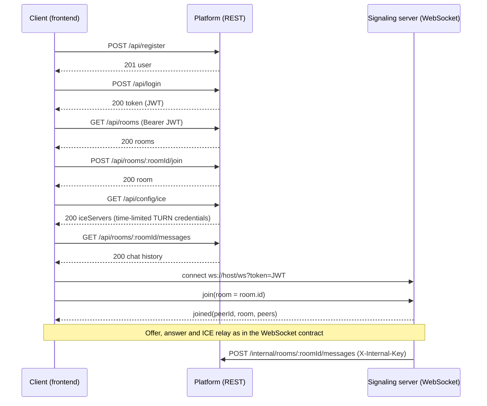

# REST API Contract v1.0

This document defines the REST API provided by the WebRTC meeting app's platform backend
(`/platform`, owned by Member 3). The frontend (Member 1) consumes it. The real-time service
(Member 2) uses a small part of it for chat persistence and statistics.

The authentication token is defined in [token-contract.md](./token-contract.md). The signaling
protocol is defined in [websocket-contract.md](./websocket-contract.md). This document must not
change either of them.

## Conventions

| Topic          | v1.0 rule                                                                                                                                   |
| -------------- | ------------------------------------------------------------------------------------------------------------------------------------------- |
| Base path      | All public endpoints start with `/api`. In a deployed environment, Nginx routes `/api/` to the platform service and `/ws` to the real-time. |
| Format         | Request and response bodies are UTF-8 JSON. Requests with a body must send `Content-Type: application/json`.                                |
| Authentication | Protected endpoints require `Authorization: Bearer <JWT>`. The JWT is the one issued by `POST /api/login`.                                  |
| Identifiers    | All identifiers (`id`, `userId`, `roomId`, message `id`) are opaque, non-empty strings. Clients must not parse them or assume an order.     |
| Timestamps     | ISO 8601 in UTC with milliseconds, for example `2026-11-10T03:30:00.000Z`. This matches the `ts` field of the WebSocket `chat` message.     |
| Unknown fields | The server ignores unknown request fields. Clients must ignore unknown response fields.                                                     |
| Transport      | Use HTTPS outside local development.                                                                                                        |

## Endpoint overview

| Method   | Path                               | Auth                   | Owner of the data | Purpose                                                          |
| -------- | ---------------------------------- | ---------------------- | ----------------- | ---------------------------------------------------------------- |
| `POST`   | `/api/register`                    | None                   | Platform          | Create a user account.                                           |
| `POST`   | `/api/login`                       | None                   | Platform          | Verify credentials and issue a JWT.                              |
| `GET`    | `/api/me`                          | JWT                    | Platform          | Return the current user.                                         |
| `GET`    | `/api/rooms`                       | JWT                    | Platform          | List rooms.                                                      |
| `POST`   | `/api/rooms`                       | JWT                    | Platform          | Create a room.                                                   |
| `GET`    | `/api/rooms/:roomId`               | JWT                    | Platform          | Return one room.                                                 |
| `POST`   | `/api/rooms/:roomId/join`          | JWT                    | Platform          | Check that the user may join a room before the WebSocket `join`. |
| `DELETE` | `/api/rooms/:roomId`               | JWT (creator or admin) | Platform          | Delete a room and its chat history.                              |
| `GET`    | `/api/rooms/:roomId/messages`      | JWT                    | Platform          | Return stored chat history, newest page first.                   |
| `GET`    | `/api/config/ice`                  | JWT                    | Platform          | Return STUN/TURN servers with time-limited credentials.          |
| `GET`    | `/api/admin/stats`                 | JWT (admin)            | Platform          | Return usage statistics.                                         |
| `POST`   | `/internal/rooms/:roomId/messages` | Internal key           | Platform          | Real-time service stores a chat message.                         |

The `/internal/*` endpoints are for service-to-service calls only. Nginx must not expose them to
the internet (see [Internal endpoints](#internal-endpoints)).

## Authentication

### `POST /api/register`

Creates an account. It does not return a token; the client then calls `POST /api/login`.

Request:

```json
{ "username": "alex", "password": "correct horse battery" }
```

Response `201 Created`:

```json
{
  "user": {
    "id": "user-123",
    "username": "alex",
    "role": "user",
    "createdAt": "2026-11-10T03:30:00.000Z"
  }
}
```

| Status | Error code         | When                                                                                |
| ------ | ------------------ | ----------------------------------------------------------------------------------- |
| `400`  | `VALIDATION_ERROR` | `username` or `password` breaks the rules in [Validation rules](#validation-rules). |
| `409`  | `USERNAME_TAKEN`   | The username already exists (compared case-insensitively).                          |
| `429`  | `RATE_LIMITED`     | Too many requests from this client.                                                 |

### `POST /api/login`

Verifies the credentials and issues the JWT defined in the token contract.

Request:

```json
{ "username": "alex", "password": "correct horse battery" }
```

Response `200 OK`:

```json
{
  "token": "<JWT>",
  "tokenType": "Bearer",
  "expiresIn": 3600,
  "user": { "id": "user-123", "username": "alex", "role": "user" }
}
```

The JWT payload contains exactly `userId`, `username`, `iat` and `exp`, signed with `HS256` and
`JWT_SECRET`, and expires one hour after issuance. `userId` is the same value as `user.id` and
must be a string. The token does **not** contain the role. The platform reads the role from the
database on every protected request, so the token contract stays unchanged.

The client uses the same token for REST (`Authorization` header) and for the WebSocket
(`ws://host/ws?token=<JWT>`). The client should store the token in memory or `sessionStorage` and
log in again after `TOKEN_EXPIRED`. There is no refresh endpoint in v1.0.

| Status | Error code            | When                                                                                   |
| ------ | --------------------- | -------------------------------------------------------------------------------------- |
| `400`  | `VALIDATION_ERROR`    | A field is missing or has the wrong type.                                              |
| `401`  | `INVALID_CREDENTIALS` | The username does not exist or the password is wrong. Both cases use the same message. |
| `429`  | `RATE_LIMITED`        | Too many requests from this client.                                                    |

### `GET /api/me`

Response `200 OK`:

```json
{ "user": { "id": "user-123", "username": "alex", "role": "user" } }
```

Errors: `401 INVALID_TOKEN`, `401 TOKEN_EXPIRED`.

## Rooms

A room has this shape:

```json
{
  "id": "room-7f3a",
  "name": "Study room",
  "maxPeers": 4,
  "createdBy": { "id": "user-123", "username": "alex" },
  "createdAt": "2026-11-10T03:30:00.000Z"
}
```

**The room `id` is the value the client sends as `room` in the WebSocket `join` message.** The
room `name` is only a label for the lobby. `maxPeers` is informational; the real-time service
enforces the limit and replies `ROOM_FULL` when a room is full.

### `GET /api/rooms`

Response `200 OK`: `{ "rooms": [ <room>, ... ] }`, sorted by `createdAt` descending. The list is
not paginated because the number of rooms is capped (see [Limits](#limits)).

### `POST /api/rooms`

Request:

```json
{ "name": "Study room" }
```

Response `201 Created`: `{ "room": <room> }`, with a `Location: /api/rooms/<id>` header.

| Status | Error code           | When                                                              |
| ------ | -------------------- | ----------------------------------------------------------------- |
| `400`  | `VALIDATION_ERROR`   | `name` breaks the rules in [Validation rules](#validation-rules). |
| `409`  | `ROOM_NAME_TAKEN`    | A room with this name exists (compared case-insensitively).       |
| `409`  | `ROOM_LIMIT_REACHED` | The maximum number of rooms exists.                               |

### `GET /api/rooms/:roomId`

Response `200 OK`: `{ "room": <room> }`. Error: `404 ROOM_NOT_FOUND`.

### `POST /api/rooms/:roomId/join`

The client calls this before opening or using the WebSocket `join`. The platform checks that the
room exists and that the user may enter it. It does not check live occupancy; the signaling
server decides that.

Request body: none.

Response `200 OK`: `{ "room": <room> }`. The client then sends `{ "type": "join", "room": "<room.id>" }`
over the WebSocket.

Errors: `404 ROOM_NOT_FOUND`.

### `DELETE /api/rooms/:roomId`

Allowed for the room creator and for admins. Deletes the room and its stored messages.
Response `204 No Content`. Peers already connected through the WebSocket are not disconnected in
v1.0.

Errors: `403 FORBIDDEN`, `404 ROOM_NOT_FOUND`.

## Chat history

### `GET /api/rooms/:roomId/messages`

Returns stored chat messages so that a client can show history after joining.

| Query parameter | Type    | Default | Meaning                                                 |
| --------------- | ------- | ------- | ------------------------------------------------------- |
| `limit`         | Integer | `50`    | Page size, from `1` to `100`.                           |
| `before`        | String  | None    | Message `id`. Return only messages older than this one. |

Response `200 OK`:

```json
{
  "messages": [
    {
      "id": "msg-1001",
      "roomId": "room-7f3a",
      "userId": "user-123",
      "username": "alex",
      "text": "Hello!",
      "ts": "2026-11-10T03:30:00.000Z"
    }
  ],
  "hasMore": true,
  "nextBefore": "msg-1001"
}
```

`messages` are sorted from oldest to newest within the page. To load an older page, the client
passes `nextBefore` as `before`. `nextBefore` is `null` when `hasMore` is `false`.

Errors: `400 VALIDATION_ERROR` (bad `limit` or `before`), `404 ROOM_NOT_FOUND`.

## ICE server configuration

### `GET /api/config/ice`

Returns the `iceServers` array for `new RTCPeerConnection({ iceServers })`. TURN credentials are
time-limited, so the client must call this endpoint before each call and must not cache the result
longer than `ttl` seconds.

Response `200 OK`:

```json
{
  "iceServers": [
    { "urls": "stun:turn.example.com:3478" },
    {
      "urls": [
        "turn:turn.example.com:3478?transport=udp",
        "turn:turn.example.com:3478?transport=tcp",
        "turns:turn.example.com:5349?transport=tcp"
      ],
      "username": "1794285000:user-123",
      "credential": "base64-hmac-value"
    }
  ],
  "ttl": 3600,
  "expiresAt": "2026-11-10T04:30:00.000Z"
}
```

The platform builds the TURN credential with the standard "TURN REST API" scheme that coturn
supports through `use-auth-secret`:

| Field        | Value                                                                                                                  |
| ------------ | ---------------------------------------------------------------------------------------------------------------------- |
| `username`   | `<expiry>:<userId>`, where `<expiry>` is the Unix time in seconds at which the credential stops working (now + `ttl`). |
| `credential` | `base64( HMAC-SHA1( TURN_SECRET, username ) )`.                                                                        |

`TURN_SECRET` is a separate secret shared only by the platform service and the coturn server
(`static-auth-secret`). It must not be the same value as `JWT_SECRET` and must not be committed.

Errors: `401 INVALID_TOKEN`, `401 TOKEN_EXPIRED`.

## Admin statistics

### `GET /api/admin/stats`

Only users whose database role is `admin` may call this endpoint.

Response `200 OK`:

```json
{
  "users": { "total": 12 },
  "rooms": { "total": 5 },
  "messages": { "total": 340 },
  "realtime": { "connections": 4, "rooms": 2, "peers": 4 },
  "generatedAt": "2026-11-10T03:30:00.000Z"
}
```

`realtime` comes from the real-time service (see [Internal endpoints](#internal-endpoints)). If
the real-time service cannot be reached, the platform returns `"realtime": null` instead of
failing the whole request.

Errors: `401 INVALID_TOKEN`, `401 TOKEN_EXPIRED`, `403 FORBIDDEN`.

## Internal endpoints

These endpoints connect the two backend services. They require the header
`X-Internal-Key: <INTERNAL_API_KEY>`, where `INTERNAL_API_KEY` is a private value shared only by
the platform and real-time services. A missing or wrong key returns `401 UNAUTHORIZED`.

### `POST /internal/rooms/:roomId/messages` (platform)

The real-time service calls this after it broadcasts a `chat` message, so the message appears in
`GET /api/rooms/:roomId/messages`. A failed call must not stop the live broadcast.

Request:

```json
{
  "userId": "user-123",
  "username": "alex",
  "text": "Hello!",
  "ts": "2026-11-10T03:30:00.000Z"
}
```

Response `201 Created`: `{ "id": "msg-1001" }`. Errors: `400 VALIDATION_ERROR`, `404 ROOM_NOT_FOUND`.

### `GET /internal/stats` (real-time)

The real-time service exposes this endpoint, protected by the same `X-Internal-Key` header. The
platform calls it to fill `realtime` in `GET /api/admin/stats`.

Response `200 OK`: `{ "connections": 4, "rooms": 2, "peers": 4 }`.

## Errors

Every error response uses the same JSON shape, which matches the HTTP errors of the real-time
service:

```json
{ "error": "ROOM_NOT_FOUND", "message": "The room does not exist." }
```

Validation errors may add a `details` array:

```json
{
  "error": "VALIDATION_ERROR",
  "message": "The request body is invalid.",
  "details": [{ "field": "username", "message": "Must be 3 to 32 characters." }]
}
```

| HTTP status | Error code               | Meaning                                                                      |
| ----------- | ------------------------ | ---------------------------------------------------------------------------- |
| `400`       | `VALIDATION_ERROR`       | The body, path or query is missing a field or a value is invalid.            |
| `401`       | `INVALID_TOKEN`          | The `Authorization` header is missing or the JWT is invalid.                 |
| `401`       | `TOKEN_EXPIRED`          | The JWT has expired. The client must log in again.                           |
| `401`       | `INVALID_CREDENTIALS`    | Wrong username or password.                                                  |
| `401`       | `UNAUTHORIZED`           | A missing or wrong internal key.                                             |
| `403`       | `FORBIDDEN`              | The user is authenticated but not allowed to do this.                        |
| `404`       | `ROOM_NOT_FOUND`         | The room does not exist.                                                     |
| `404`       | `NOT_FOUND`              | The path does not exist.                                                     |
| `405`       | `METHOD_NOT_ALLOWED`     | The path exists but not for this method. The response has an `Allow` header. |
| `409`       | `USERNAME_TAKEN`         | Registration with an existing username.                                      |
| `409`       | `ROOM_NAME_TAKEN`        | Room creation with an existing name.                                         |
| `409`       | `ROOM_LIMIT_REACHED`     | The maximum number of rooms exists.                                          |
| `413`       | `PAYLOAD_TOO_LARGE`      | The body is larger than the limit.                                           |
| `415`       | `UNSUPPORTED_MEDIA_TYPE` | A request body is not `application/json`.                                    |
| `429`       | `RATE_LIMITED`           | Too many requests. The response has a `Retry-After` header in seconds.       |
| `500`       | `INTERNAL_ERROR`         | Unexpected server error. The message never contains internal details.        |

`INVALID_TOKEN` and `TOKEN_EXPIRED` use the same names as the WebSocket error codes in the
token contract, so the frontend can handle both in one place.

## Validation rules

| Field       | Rule                                                                       |
| ----------- | -------------------------------------------------------------------------- |
| `username`  | 3 to 32 characters: letters, digits, `_`, `.` and `-`.                     |
| `password`  | 8 to 72 bytes (the limit of bcrypt). The server stores only a salted hash. |
| Room `name` | 1 to 64 characters after trimming leading and trailing spaces.             |
| Chat `text` | 1 to 2000 characters.                                                      |

## Limits

| Limit                                      | v1.0 value                                   |
| ------------------------------------------ | -------------------------------------------- |
| Maximum rooms                              | 100                                          |
| Maximum peers per room                     | 4 (same as the WebSocket contract)           |
| Request body size                          | 16 KB                                        |
| `POST /api/login` and `POST /api/register` | 10 requests per minute per client IP address |
| Other `/api` endpoints                     | 120 requests per minute per user             |
| Access token lifetime                      | 1 hour                                       |
| TURN credential lifetime (`ttl`)           | 3600 seconds                                 |

## Typical client flow



## Configuration shared between services

| Variable           | Used by             | Meaning                                                             |
| ------------------ | ------------------- | ------------------------------------------------------------------- |
| `JWT_SECRET`       | Platform, real-time | Signs (platform) and verifies (real-time) the JWT.                  |
| `TURN_SECRET`      | Platform, coturn    | Signs and verifies time-limited TURN credentials. Not `JWT_SECRET`. |
| `INTERNAL_API_KEY` | Platform, real-time | Authenticates the `/internal/*` calls between the two services.     |
| `PLATFORM_PORT`    | Platform            | Port of the REST service. It must differ from the real-time `PORT`. |

Real secret values are never committed. Add only placeholder names to `.env.example`.

## Change policy

Any change to this contract requires approval from all three team members and a version bump.
Implementations must not silently change the meaning or fields of v1.0 endpoints.
