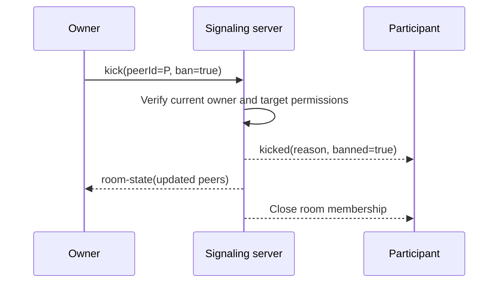
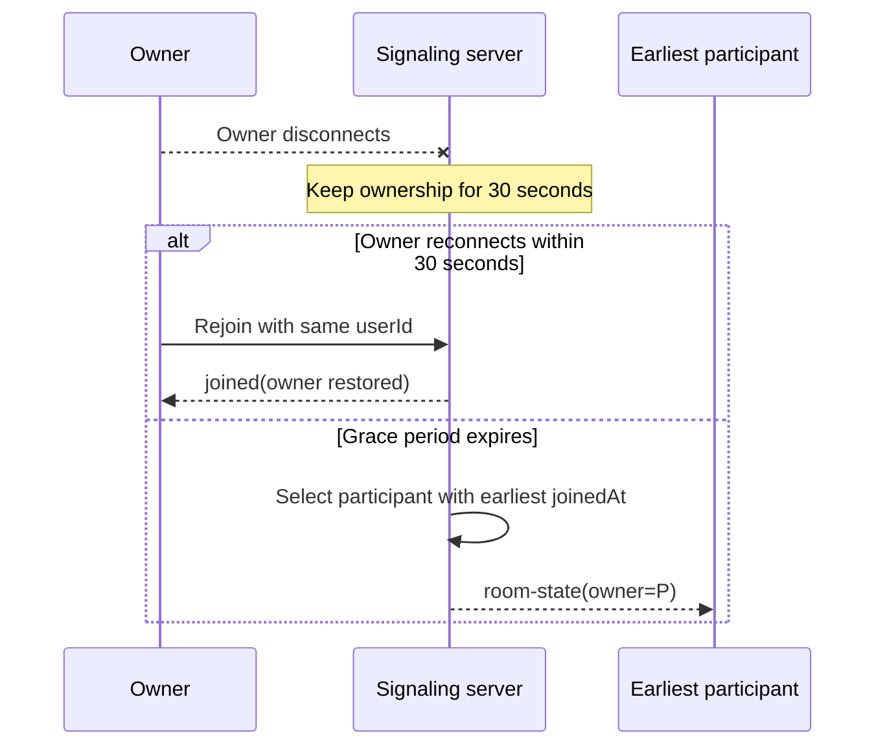

# WebSocket Contract v1.1

This document defines proposed v1.1 changes. **Needs approval from all 3 members before freeze.**

## Connection and message format

Connect to `ws://host/ws?token=<JWT>`. In a deployed HTTPS environment, use the equivalent
`wss://` URL. Admin live feed clients will connect to `ws://host/ws/admin?token=<JWT>`; this is a
P2 endpoint. The JWT contract is documented in [token-contract.md](./token-contract.md).

All application messages are JSON text frames using the envelope
`{ "type": string, ...fields }`. Each connection receives a server-generated `peerId`, unique
among the peers currently connected to the service. A `room` is a non-empty string. A connection
may be in one room at a time. `sdp` is an SDP string, and `candidate` is an ICE candidate object
as supplied by the browser's WebRTC API.

| Type              | Sender                                               | Fields                                                                                                                            | Meaning                                                                                                                           |
| ----------------- | ---------------------------------------------------- | --------------------------------------------------------------------------------------------------------------------------------- | --------------------------------------------------------------------------------------------------------------------------------- |
| `join`            | Client                                               | `room`, optional `settings` (room creator only)                                                                                   | Join the named room; the first join creates it and may set initial settings.                                                      |
| `joined`          | Server, to the joiner only                           | `peerId`, `room`, `you`, `owner`, `settings`, `peers: [{peerId, userId, username, role}]`                                         | Confirms the join with caller, owner, settings and other peers.                                                                   |
| `peer-joined`     | Server, to the other peers in the room               | `peerId`, `username`                                                                                                              | Announces a newly joined peer.                                                                                                    |
| `leave`           | Client                                               | `room`                                                                                                                            | Leave the named room.                                                                                                             |
| `peer-left`       | Server, to the other peers in the room               | `peerId`                                                                                                                          | Announces that a peer has left or disconnected.                                                                                   |
| `offer`           | Client; server forwards to `to`                      | `to`, `sdp`, `from` (added by server)                                                                                             | Relays an SDP offer to the addressed peer in the same room.                                                                       |
| `answer`          | Client; server forwards to `to`                      | `to`, `sdp`, `from` (added by server)                                                                                             | Relays an SDP answer to the addressed peer in the same room.                                                                      |
| `ice-candidate`   | Client; server forwards to `to`                      | `to`, `candidate`, `from` (added by server)                                                                                       | Relays an ICE candidate to the addressed peer in the same room.                                                                   |
| `chat`            | Client; server broadcasts to the room                | `text`; server fields: `from`, `username`, `ts`                                                                                   | Broadcasts a text message to every peer in the room, including its sender. `ts` is the server's UTC timestamp in ISO 8601 format. |
| `media-state`     | Client; server broadcasts to other peers in the room | `kind`, `active`, `streamId`; server field: `from` (added)                                                                        | Announces camera, microphone, or screen state. The server retains the latest state for admin room details.                        |
| `update-settings` | Owner or admin                                       | `settings: {maxPeers?, locked?, chatEnabled?, screenShare?}`                                                                      | Validates and applies room settings, then broadcasts `room-state`.                                                                |
| `kick`            | Owner or admin                                       | `peerId`, optional `ban`, `reason`                                                                                                | Removes the target from this room; an optional ban lasts until the room closes.                                                   |
| `mute-peer`       | Owner or admin                                       | `peerId`, `kind: "audio"                                                                                                          | "video"                                                                                                                           | "screen"` | Sends a `force-mute` request to the target.             |
| `mute-all`        | Owner or admin                                       | `kind: "audio"                                                                                                                    | "video"                                                                                                                           | "screen"` | Sends `force-mute` requests to other room participants. |
| `transfer-owner`  | Owner or admin                                       | `peerId`                                                                                                                          | Transfers room ownership to a peer and broadcasts `room-state`.                                                                   |
| `close-room`      | Owner or admin                                       | Optional `reason`                                                                                                                 | Closes the room and sends `room-closed` to its peers.                                                                             |
| `room-state`      | Server, to room                                      | `room`, `owner: {peerId, userId}` (nullable before an owner is assigned), `settings`, `peers: [{peerId, userId, username, role}]` | Publishes current room state after membership, settings or owner changes.                                                         |
| `kicked`          | Server, to kicked peer only                          | `reason`, `banned`                                                                                                                | Confirms removal from the room.                                                                                                   |
| `force-mute`      | Server, to target peer                               | `kind`, `by` (actor `userId`)                                                                                                     | Requests that the target mute its local track; it is not enforceable by the server.                                               |
| `room-closed`     | Server, to former room peers                         | `reason`, `by` (actor `userId`)                                                                                                   | Announces room closure.                                                                                                           |
| `announcement`    | Server, to room or all peers                         | `text`, `from` (admin `userId`)                                                                                                   | Broadcasts an admin announcement (P2).                                                                                            |
| `error`           | Server                                               | `code`, `message`                                                                                                                 | Reports a rejected message or connection error. The connection is closed only for the errors marked as closing below.             |

`room-state` and `joined` peer records use the site role (`user` or `admin`) in `role`. The
owner is independently identified by `owner.userId` and `owner.peerId`; an admin joining a room
is a participant unless that admin is explicitly the room owner.

### JSON examples

Client joins a room:

```json
{ "type": "join", "room": "study-room" }
```

Server confirms to the joiner; `peers` may be empty:

```json
{
  "type": "joined",
  "peerId": "peer-a",
  "room": "study-room",
  "you": { "peerId": "peer-a", "userId": "user-a", "username": "Alex", "role": "user" },
  "owner": { "peerId": "peer-a", "userId": "user-a" },
  "settings": {
    "maxPeers": 4,
    "locked": false,
    "chatEnabled": true,
    "screenShare": "everyone"
  },
  "peers": [{ "peerId": "peer-b", "userId": "user-b", "username": "Sam", "role": "user" }]
}
```

Server tells existing room members about the join:

```json
{ "type": "peer-joined", "peerId": "peer-a", "username": "Alex" }
```

Client leaves:

```json
{ "type": "leave", "room": "study-room" }
```

Server announces that a peer left:

```json
{ "type": "peer-left", "peerId": "peer-a" }
```

Client sends an offer to a peer:

```json
{ "type": "offer", "to": "peer-b", "sdp": "v=0\r\n..." }
```

Server forwards it with the sender's peer ID:

```json
{ "type": "offer", "from": "peer-a", "to": "peer-b", "sdp": "v=0\r\n..." }
```

Client sends an answer:

```json
{ "type": "answer", "to": "peer-a", "sdp": "v=0\r\n..." }
```

Server forwards the answer with the sender's peer ID:

```json
{ "type": "answer", "from": "peer-b", "to": "peer-a", "sdp": "v=0\r\n..." }
```

Client sends an ICE candidate:

```json
{
  "type": "ice-candidate",
  "to": "peer-b",
  "candidate": {
    "candidate": "candidate:1 1 UDP 2122260223 192.0.2.1 50000 typ host",
    "sdpMid": "0",
    "sdpMLineIndex": 0
  }
}
```

Server forwards the candidate with the sender's peer ID:

```json
{
  "type": "ice-candidate",
  "from": "peer-a",
  "to": "peer-b",
  "candidate": {
    "candidate": "candidate:1 1 UDP 2122260223 192.0.2.1 50000 typ host",
    "sdpMid": "0",
    "sdpMLineIndex": 0
  }
}
```

Client sends chat; server broadcasts the normalized message, including to the sender:

```json
{ "type": "chat", "text": "Hello!" }
```

```json
{
  "type": "chat",
  "from": "peer-a",
  "username": "Alex",
  "text": "Hello!",
  "ts": "2026-11-10T03:30:00.000Z"
}
```

Example server error:

```json
{ "type": "error", "code": "NOT_IN_ROOM", "message": "Join a room before sending this message." }
```

Client announces screen sharing:

```json
{ "type": "media-state", "kind": "screen", "active": true, "streamId": "screen-stream-1" }
```

Server broadcasts the state to the other peers in the room:

```json
{
  "type": "media-state",
  "from": "peer-a",
  "kind": "screen",
  "active": true,
  "streamId": "screen-stream-1"
}
```

Client announces that it stopped sharing:

```json
{ "type": "media-state", "kind": "screen", "active": false, "streamId": "screen-stream-1" }
```

Owner changes settings:

```json
{ "type": "update-settings", "settings": { "maxPeers": 3, "locked": true } }
```

Server broadcasts the resulting room state:

```json
{
  "type": "room-state",
  "room": "study-room",
  "owner": { "peerId": "peer-a", "userId": "user-a" },
  "settings": { "maxPeers": 3, "locked": true, "chatEnabled": true, "screenShare": "everyone" },
  "peers": [{ "peerId": "peer-b", "userId": "user-b", "username": "Sam", "role": "user" }]
}
```

Owner kicks a participant:

```json
{ "type": "kick", "peerId": "peer-b", "ban": true, "reason": "Repeated disruption" }
```

Kicked peer receives:

```json
{ "type": "kicked", "reason": "Repeated disruption", "banned": true }
```

Owner transfers ownership and closes the room:

```json
{ "type": "transfer-owner", "peerId": "peer-b" }
```

```json
{ "type": "close-room", "reason": "Meeting ended" }
```

All room peers receive:

```json
{ "type": "room-closed", "reason": "Meeting ended", "by": "peer-a" }
```

## Track changes and renegotiation

After the initial connection, a peer that adds or removes a track (for example, starting or
stopping screen sharing) creates a new `offer` on the same `RTCPeerConnection`. The remote peer
sets it as the remote description, creates an `answer`, and sends that answer over the same
connection. Camera and screen tracks use separate `MediaStream` instances.

Use the perfect negotiation pattern to resolve simultaneous offers. The peer whose `peerId` is
lexicographically smaller is polite; the other peer is impolite. If an offer arrives while the
polite peer is making an offer or is not in the stable signaling state, it rolls back its local
offer and accepts the incoming offer. The impolite peer ignores an offer collision. Both peers
continue using the same peer connection and ICE candidate relay.

| Situation          | Polite peer (smaller `peerId`)                                     | Impolite peer (larger `peerId`)                       |
| ------------------ | ------------------------------------------------------------------ | ----------------------------------------------------- |
| No offer collision | Accepts the offer and answers normally.                            | Accepts the offer and answers normally.               |
| Offer collision    | Rolls back its local offer, accepts the remote offer, and answers. | Ignores the incoming offer and keeps its local offer. |

`peer-left` means that peer has no active media state, including camera and screen sharing. A
receiver must clear all remote media state for that peer when it receives `peer-left`.

### Screen-sharing renegotiation sequence

```mermaid
sequenceDiagram
    participant A as Peer A
    participant S as Signaling server
    participant B as Peer B
    A->>A: Add screen track in separate MediaStream
    A->>S: media-state(kind=screen, active=true, streamId)
    S-->>B: media-state(from=A, kind=screen, active=true, streamId)
    A->>A: Create new offer on existing RTCPeerConnection
    A->>S: offer(to=B, sdp)
    S-->>B: offer(from=A, to=B, sdp)
    B->>B: Set remote offer and create answer
    B->>S: answer(to=A, sdp)
    S-->>A: answer(from=B, to=A, sdp)
    Note over A,B: ICE updates; camera and screen tracks flow
```

## Relay and call-flow rules

- The signaling server never inspects or modifies `sdp` or `candidate`; it only relays those
  values to the addressed peer in the same room.
- During initial room joining, the new joiner receives `joined` with the list of existing peers
  and then creates an offer to each existing peer. Existing peers only answer those initial
  offers; they do not initiate an offer to the new joiner. Track changes after connection may
  trigger renegotiation by either peer as described above.
- `peer-joined` is sent to existing peers after the new peer has been added to the room.
- `media-state` messages are forwarded to all other peers in the sender's room with the sender's
  `peerId` in `from`; the server does not inspect the media-state fields.
- On `peer-joined`, existing clients should announce their currently active camera and screen
  states again. This lets a new joiner classify media streams, including a screen share already
  in progress, without the server storing media state.
- On a normal `leave` or connection close, the server removes the peer from its room and sends
  `peer-left` to the remaining room members; this implies the peer's media-state is inactive.

## Errors and close codes

When an error closes a connection, the server sends the `error` message first, then closes the
WebSocket with the listed application close code. An error marked “No” leaves the connection open
so the client can correct the request and continue. Close code `1000` is used for a normal client
disconnect, not for an error.

| Code                   | When it happens                                                                                                                     | Closes connection? | WebSocket close code |
| ---------------------- | ----------------------------------------------------------------------------------------------------------------------------------- | ------------------ | -------------------- |
| `INVALID_TOKEN`        | The token is missing, malformed, has an invalid signature, or has invalid required claims.                                          | Yes                | `4001`               |
| `TOKEN_EXPIRED`        | The token's expiration time has passed.                                                                                             | Yes                | `4002`               |
| `RATE_LIMITED`         | The connection exceeds the configured per-second message limit (30 by default).                                                     | Yes                | `4003`               |
| `ROOM_FULL`            | A join would exceed the room peer limit.                                                                                            | No                 | N/A                  |
| `NOT_IN_ROOM`          | A room-scoped message is sent before joining, or `leave.room` does not match the connection's current room.                         | No                 | N/A                  |
| `PEER_NOT_FOUND`       | A relay target is not a connected peer in the sender's current room.                                                                | No                 | N/A                  |
| `BAD_MESSAGE`          | A frame is not valid JSON, has an unknown type, misses required fields, has invalid field types, or exceeds the message-size limit. | Yes                | `4004`               |
| `TOO_MANY_CONNECTIONS` | The user exceeds the per-user connection limit.                                                                                     | Yes                | `4005`               |
| `FORBIDDEN`            | The site role or current room role is not permitted to perform the requested action.                                                | No                 | N/A                  |
| `ROOM_LOCKED`          | A non-owner, non-admin attempts to join a locked room.                                                                              | No                 | N/A                  |
| `ROOM_CLOSED`          | An operation targets a room that has been closed.                                                                                   | No                 | N/A                  |
| `BANNED_FROM_ROOM`     | A banned user attempts to rejoin before the room closes.                                                                            | No                 | N/A                  |
| `INVALID_SETTING`      | Room settings contain unknown fields, wrong types, or out-of-range values.                                                          | No                 | N/A                  |
| `MAX_ROOMS_REACHED`    | Creating a room would exceed the global room limit.                                                                                 | No                 | N/A                  |
| `USER_DENIED`          | An admin denies an active user's connections or a denied user attempts to reconnect (P2).                                           | Yes                | `4006`               |

If authentication fails before the WebSocket is accepted, the server rejects the upgrade with an
HTTP error instead; it cannot send a WebSocket `error` frame or close code in that case. Once the
WebSocket is accepted, the server sends the `error` frame before closing as described above.

## Limits

| Limit                                             | v1.1 default                  |
| ------------------------------------------------- | ----------------------------- |
| Maximum peers per room (including the local peer) | 4                             |
| Maximum connections per user                      | 3                             |
| Rate limit per connection                         | 30 client messages per second |
| Maximum message size                              | 64 KB (65,536 bytes)          |

## Roles and permission matrix

The site role comes only from the verified JWT claim `role` (`user` or `admin`); an omitted
claim means `user`. Never accept a role from a WebSocket message body. Room role is maintained
in server state as `owner` or `participant`; ownership is tied to `userId`, not a connection's
`peerId`. An admin joining a room is a participant with an admin badge and does not become owner.

| Action                                    | participant     | owner                    | admin          |
| ----------------------------------------- | --------------- | ------------------------ | -------------- |
| Join, chat, camera/mic                    | yes             | yes                      | yes            |
| Share screen                              | Per room policy | yes                      | yes            |
| Change room settings                      | no              | yes                      | yes (any room) |
| Kick / ban from room                      | no              | yes (not admins or self) | yes (any room) |
| Mute-peer / mute-all request              | no              | yes                      | yes            |
| Transfer owner                            | no              | yes                      | yes            |
| Close room                                | no              | yes                      | yes            |
| Join a locked room                        | no              | yes                      | yes            |
| Join a full room                          | no              | no                       | yes            |
| View all rooms, connections, stats, audit | no              | no                       | yes            |
| Edit global limits, announce              | no              | no                       | yes            |

Mute is a peer-to-peer client request: the server cannot force a browser to mute its local
microphone or camera. A receiving client may comply, ignore, or report the request; an
authoritative mute requires server-controlled media routing.

The server checks the verified site role and current room ownership for every privileged action;
client-supplied `role`, `owner`, or `isAdmin` fields never grant permission. When `chatEnabled` is
false, chat from a non-owner/non-admin returns `FORBIDDEN`. When `screenShare` is `"owner"`, an
active screen `media-state` from a non-owner/non-admin returns `FORBIDDEN`. Owners attempting to
kick or ban themselves or an admin also receive `FORBIDDEN`.

## Room lifecycle

- The first join creates a room; a non-admin creator is owner and may supply optional `settings`
  in `join`. An admin who creates or joins a room remains a participant; an admin-created room
  has no owner until ownership is transferred. Defaults are `maxPeers: 4`, `locked: false`, `chatEnabled: true`, and
  `screenShare: "everyone"`. A room's `maxPeers` cannot exceed global `maxPeersPerRoom`.
- A locked room rejects non-owner, non-admin joins. A full room rejects all non-admin joins,
  including the owner. Admins may join either. The creator's initial join is accepted even when
  creating a locked room.
- Lowering `maxPeers` below the existing peer count does not evict anyone; it only blocks new
  non-admin joins.
- Ownership is retained for 30 seconds after the owner's last room connection disconnects or
  leaves. A returning connection for that `userId` resumes ownership. Otherwise ownership
  transfers to the participant with the earliest `joinedAt` and `room-state` is broadcast.
- An empty room is deleted after 30 seconds. A room ban lasts until that room is deleted.
- Settings updates with unknown keys, invalid types, or values outside the allowed range return
  `INVALID_SETTING`.

### Owner kicks a participant



### Owner leaves; ownership transfers



## Admin HTTP API

Admin requests use `Authorization: Bearer <JWT>`. Missing/invalid tokens return HTTP 401;
valid non-admin tokens return HTTP 403. Development CORS is allowed only for `http://localhost`
origins and is disabled in production.

| Method + path                            | Purpose                                                                       | Priority |
| ---------------------------------------- | ----------------------------------------------------------------------------- | -------- |
| `GET /admin/stats`                       | Current/peak connections, rooms, peers, messages/sec, errors by code, uptime. | P1       |
| `GET /admin/rooms`                       | Live room IDs, owners, peer counts, settings and creation times.              | P1       |
| `GET /admin/rooms/:id`                   | Room detail including peer and media-state records.                           | P2       |
| `PATCH /admin/rooms/:id/settings`        | Body is a settings object; validates and applies room settings.               | P2       |
| `POST /admin/rooms/:id/kick`             | Kick by `peerId` or `userId`; optional `ban`.                                 | P1       |
| `POST /admin/rooms/:id/mute`             | Request peer mute.                                                            | P2       |
| `POST /admin/rooms/:id/transfer-owner`   | Transfer ownership by `peerId`.                                               | P2       |
| `POST /admin/rooms/:id/close`            | Close room with optional reason.                                              | P1       |
| `GET /admin/connections`                 | List sockets, user, IP, room, connection time and message rate.               | P2       |
| `POST /admin/users/:userId/disconnect`   | Disconnect the user's sockets.                                                | P2       |
| `POST /admin/users/:userId/deny`         | Deny reconnects for `{ "minutes": number }`.                                  | P2       |
| `DELETE /admin/users/:userId/deny`       | Lift a user deny.                                                             | P2       |
| `POST /admin/announce`                   | Broadcast `{ "text": string, "room"?: string }`.                              | P2       |
| `GET /admin/config`, `PUT /admin/config` | Read/update global limits and defaults.                                       | P2       |
| `GET /admin/audit`                       | Query audit entries by limit, action, room, or user.                          | P2       |

## Admin live feed (P2)

Connect using `ws://host/ws/admin?token=<JWT>` (or `wss://` in production). Admin-only feed
events are `stats` every two seconds, `room-created`, `room-updated`, `room-closed`,
`peer-joined`, `peer-left`, and `audit`. A non-admin token is rejected during the WebSocket
upgrade. Admin actions use the configured rate limit; the default is 30 messages/requests per
second per connection or admin user.

An audit entry has the shape
`{id, ts, actor: {userId, username, role}, action, room, target, details, result}`. The in-memory
audit ring buffer holds 5,000 entries and appends JSONL records to
`/realtime/data/audit.jsonl`; runtime config is persisted to `/realtime/data/config.json`.
Both data files are git-ignored.

Global config accepts `maxPeersPerRoom`, `maxRooms`, `maxConnectionsPerUser`, `rateLimit`, and
`defaultRoomSettings`. Reducing the peer cap lowers any existing room limit above the new cap but
does not evict current peers; new rooms use the updated defaults, and settings above the cap
return `INVALID_SETTING`.

## Implementation status and deviations

P1 and P2 are implemented in the reference server and covered by
`/realtime/scripts/admin-smoke-test.js`. P3 waiting-room and room-password features are not
implemented. To satisfy the locked-room acceptance test, a room owner may join a locked room;
the permission matrix's locked-room row reflects this exception. Owners still cannot join a full
room, while admins can join either.

## Call sequence

```mermaid
sequenceDiagram
    participant A as Peer A
    participant S as Signaling server
    participant B as Peer B
    A->>S: join(room)
    S-->>A: joined(peerId, room, peers=[])
    B->>S: join(room)
    S-->>B: joined(peerId, room, peers=[A])
    S-->>A: peer-joined(B)
    B->>S: offer(to=A, sdp)
    S-->>A: offer(from=B, to=A, sdp)
    A->>S: answer(to=B, sdp)
    S-->>B: answer(from=A, to=B, sdp)
    A->>S: ice-candidate(to=B, candidate)
    S-->>B: ice-candidate(from=A, to=B, candidate)
    B->>S: ice-candidate(to=A, candidate)
    S-->>A: ice-candidate(from=B, to=A, candidate)
    Note over A,B: ICE / DTLS connected; media flows peer-to-peer
```

## Change policy

Any change to this contract requires approval from all three team members and a version bump.
This v1.1 proposal **needs approval from all 3 members before it is frozen**. Implementations
must not silently change the meaning or fields of a frozen contract.
